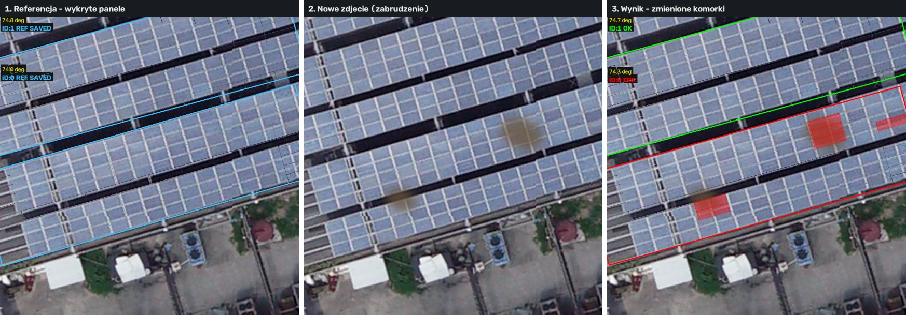
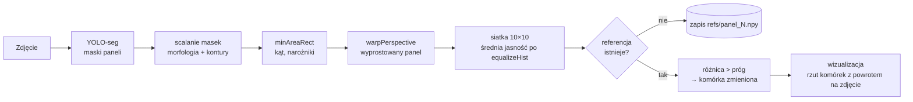

# mlWizja – wykrywanie paneli PV i zmian na ich powierzchni

System wizji komputerowej do monitoringu instalacji fotowoltaicznych:
1. **segmentuje panele** na zdjęciu modelem YOLO (Ultralytics),
2. **prostuje każdy panel** transformacją perspektywiczną i wylicza jego orientację,
3. dzieli panel na siatkę 10×10 komórek i **porównuje ją z obrazem referencyjnym**, zaznaczając miejsca, w których zmieniła się jasność (zabrudzenie, uszkodzenie, zacienienie).



*Przykład z folderu `przyklady/`. Na zdjęciu „po” dodano sztucznie dwie plamy brudu. System wykrył obie (czerwone komórki panelu 0), a panel 1 bez zmian dostał status OK.*

## Wynik na przykładzie

```
$ python Main.py przyklady/panele_referencja.jpg --no-show
Wykryto paneli: 2
  Panel 0: Panel(angle=73.9, size=852x242), referencja zapisana
  Panel 1: Panel(angle=74.8, size=818x244), referencja zapisana

$ python Main.py przyklady/panele_zabrudzenie.jpg --no-show
Wykryto paneli: 2
  Panel 0: Panel(angle=74.3, size=843x241), zmienione komórki: 6/100
  Panel 1: Panel(angle=74.8, size=820x244), zmienione komórki: 0/100
```

- Obie plamy zostały wykryte (5 komórek), panel bez zmian ma 0 fałszywych alarmów.
- Jedna komórka przy krawędzi panelu 0 to fałszywy alarm. Zabrudzenie lekko zmieniło maskę segmentacji, więc wyprostowany panel przesunął się o kilka pikseli względem referencji.

## Jak to działa



| Moduł | Odpowiada za |
|---|---|
| `src/PanelDetector.py` | inferencja YOLO, scalanie masek (`morphologyEx`), kontury, filtrowanie małych obszarów |
| `src/Panel.py` | geometria panelu: uporządkowane narożniki, kąt, macierze perspektywy `M` i `M⁻¹`, podział na komórki |
| `src/PanelAnalyzer.py` | siatka jasności z wyrównaniem histogramu, porównanie z referencją, dominujący kolor komórki (HSV) |
| `src/Visualizer.py` | rysowanie obrysów, statusów (REF / OK / ERR) i komórek zrzutowanych odwrotną perspektywą |

## Technologie

Python · PyTorch · Ultralytics YOLO (segmentacja, model `Model/best.pt`, klasa `solar-panel`) · OpenCV · NumPy

## Uruchomienie

```bash
git clone https://github.com/wikad/mlWizja.git
cd mlWizja
pip install -r requirements.txt

# 1. pierwsze zdjęcie instalacji -> zapis referencji
python Main.py przyklady/panele_referencja.jpg

# 2. kolejne zdjęcie tej samej instalacji -> wykrywanie zmian
python Main.py przyklady/panele_zabrudzenie.jpg --save wynik.jpg
```

| Opcja | Domyślnie | Opis |
|---|---|---|
| `--conf` | 0.2 | próg pewności detekcji YOLO |
| `--threshold` | 25 | o ile musi zmienić się jasność komórki (0–255) |
| `--ref-dir` | `refs` | gdzie trzymać referencje paneli |
| `--save` | – | zapis obrazu wynikowego |
| `--no-show` | – | bez okna podglądu |

Aby zacząć od nowa (nowa instalacja lub nowa referencja), usuń folder `refs/`.

## Ograniczenia i plany

- Porównanie zakłada **stałe ujęcie** (kamera stacjonarna lub ten sam punkt przelotu drona). Przy innym kadrze panele mogą dostać inne ID. Plan: dopasowanie paneli między zdjęciami po położeniu i kształcie zamiast po kolejności detekcji.
- Metoda jest wrażliwa na zmianę oświetlenia całej sceny. Częściowo kompensuje to `equalizeHist`. Plan: normalizacja względem sąsiednich komórek.
- Kolejny krok: klasyfikacja typu anomalii (brud, pęknięcie, hot-spot) osobnym modelem.
